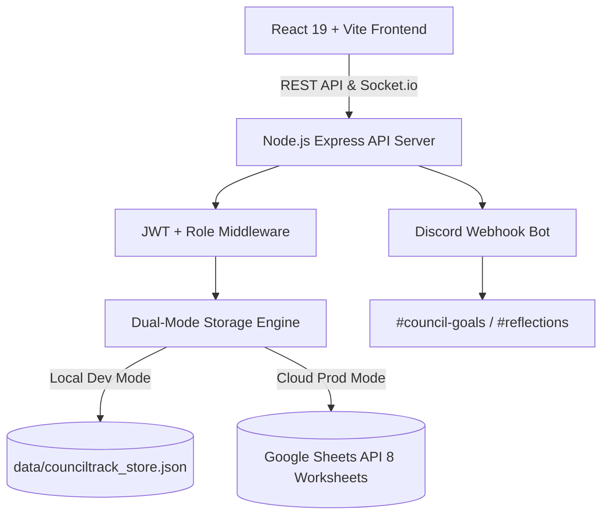

# CouncilTrack AI — Complete Project Walkthrough & Functionality Guide 🎯🤖

> **Document Type:** System Functionality & Operations Documentation  
> **Organization:** NavGurukul Dantewada Campus  
> **Applicable Version:** v2.0 (Dual-Mode Database Architecture)  
> **Target Audience:** Campus Leadership, Administrators, Council Coordinators, and Developers  

---

## 📑 Table of Contents
1. [Executive Summary & Purpose](#1-executive-summary--purpose)
2. [Where & How to Update Admin ID, Email, and Password](#2-where--how-to-update-admin-id-email-and-password)
3. [Core System Architecture & Dual-Mode Engine](#3-core-system-architecture--dual-mode-engine)
4. [User Roles & Permissions Matrix](#4-user-roles--permissions-matrix)
5. [Complete Screen-by-Screen Functionality Guide](#5-complete-screen-by-screen-functionality-guide)
   - [5.1 Public Student Voice Portal (`/feedback`)](#51-public-student-voice-portal-feedback)
   - [5.2 Council Coordinator Daily Workflow (`/council/*`)](#52-council-coordinator-daily-workflow-council)
   - [5.3 Campus Administrator Control Center (`/admin/*`)](#53-campus-administrator-control-center-admin)
6. [Daily Operating Routine (Aasan Bhasha Mein)](#6-daily-operating-routine-aasan-bhasha-mein)
7. [Automated Calculation Engine & PRD Formulas](#7-automated-calculation-engine--prd-formulas)
8. [Discord Real-time Webhook Integration](#8-discord-real-time-webhook-integration)
9. [Official 14 Councils & 25 Coordinators Directory](#9-official-14-councils--25-coordinators-directory)
10. [Local Quick Start & Verification](#10-local-quick-start--verification)

---

## 1. Executive Summary & Purpose

**CouncilTrack AI** is a centralized student governance, daily goal tracking, evening reflection, and public complaint management platform built specifically for **NavGurukul Dantewada**.

### The Core Problem Solved:
In campus environments, student coordinator bodies (Discipline, Workout, English, Culture, IT, Operations, etc.) often track daily tasks through scattered notebooks, chat messages, or verbal updates. This causes:
- Lack of accountability when morning goals slip through.
- No historical data or audit trails of campus progress.
- Student complaints getting lost or left unresolved.
- Campus administrators spending hours manually consolidating coordinator reports.

### The Solution Provided by CouncilTrack AI:
1. **Morning Daily Goals:** Council coordinators set actionable priorities each morning before classes start.
2. **Mandatory Evening Reflections:** Before curfew, coordinators review goals. Completed goals update automatically; incomplete goals strictly require an impediment reason.
3. **Frictionless Public Student Voice:** Students access a public `/feedback` link without login or registration to submit suggestions or complaints for any of the 14 councils.
4. **Real-time Executive Dashboard:** Campus leadership monitors 14 councils, completion rates, and complaint pipelines in real time via WebSockets and automated Recharts analytics.

---

## 2. Where & How to Update Admin ID, Email, and Password

You can update the Administrator credentials (**User ID**, **Email**, or **Password**) using any of the following methods depending on your environment:

### Method 1: Via the Web Admin Portal (Recommended — No Code Needed)
1. Navigate to: `http://localhost:5173/admin/login`
2. Log in with the current credentials:
   - **Email / ID:** `admin@counciltrack.org`
   - **Password:** `Admin@123`
3. Click **"Members"** in the left sidebar (URL: `/admin/members`).
4. At the top of the members list, locate **"Admin User"** (User ID: `USR_001`).
5. Click the **Edit (Pencil Icon)** button on the right side of the Admin User card.
6. In the edit modal:
   - **Email / Login ID:** Enter your new preferred email address.
   - **Password:** Enter your new desired password (minimum 4 characters).
7. Click **"Save Changes"**.
   - *Behind the scenes:* The backend automatically hashes the new password with `bcrypt` (10 rounds) and updates the persistent storage safely without exposing plain text.

---

### Method 2: Direct Edit in the Active Local Data Store (`counciltrack_store.json`)
If you are running the project in local development mode without Google Sheets, the database lives in a JSON file:

- **File Path:**  
  `counciltrack-ai/backend/data/counciltrack_store.json`

Open this file and find the first entry under `"Users"`:
```json
{
  "Users": [
    {
      "userId": "USR_001",
      "name": "Admin User",
      "email": "admin@counciltrack.org",   <--- UPDATE THIS EMAIL HERE
      "passwordHash": "$2b$10$o0O6k.vZ.7Ft/Oz/yosx9uZ731QobdnCMQntp.XHJxJHW7w3RdkW.",
      "role": "ADMIN",
      "councilId": "",
      "position": "Administrator",
      "status": "ACTIVE",
      "createdAt": "2026-11-24T10:04:59.362Z",
      "updatedAt": "2026-11-24T10:04:59.362Z"
    },
    ...
```
> [!NOTE]
> If you change the plain text password in this JSON file directly, it will not be hashed unless you generate a bcrypt hash. To log in with plain text immediately, use the built-in fallback master passwords explained in Method 3 below!

---

### Method 3: Backend Controller Fallback Master Passwords & Aliases
The authentication engine has hardcoded convenience fallbacks for the `ADMIN` role to prevent administrators from getting locked out:

- **File Path:**  
  `counciltrack-ai/backend/src/controllers/authController.js`

**Allowed Admin Login Identifiers (Lines 18–20):**
```javascript
if (uEmail === identifier || uId === identifier) return true;
if (identifier === "admin" && uRole === "admin") return true;
if (identifier === "admin@navgurukul.org" && uRole === "admin") return true;
```
*(You can log in by typing simply `admin`, `admin@counciltrack.org`, or `USR_001` in the login box!)*

**Allowed Master Passwords for ADMIN (Lines 56–60):**
```javascript
if (userRole === "ADMIN") {
  if (password === "admin@navgurukul.org" || password === "Admin@123" || password === "admin123") {
    isMatch = true;
  }
}
```
*(You can modify, add, or delete any of these master passwords directly in `authController.js` lines 56–60).*

---

### Method 4: Google Sheets Mode (If Connected to Cloud Sheet)
If your backend `.env` has `GOOGLE_SHEET_ID` configured:
1. Open your Google Drive and open the target Google Sheet.
2. Select the **`Users`** worksheet tab.
3. Row 2 corresponds to `USR_001`:
   - Column `name`: Admin User
   - Column `email`: Update email here.
   - Column `passwordHash`: Contains the bcrypt string.

---

### Method 5: Default Database Seed Files (For Fresh Resets)
When executing `npm run seed` or initializing an empty database, default admin records are pulled from:
1. `counciltrack-ai/backend/src/services/sheetsService.js` (Lines 34–45)
2. `counciltrack-ai/backend/scripts/reset_clean_seed.js` (Lines 24–34)

---

## 3. Core System Architecture & Dual-Mode Engine



### The 8 Worksheets Database Schema:
1. **`Users`**: Stores Admin and 25 Coordinators with `userId`, `email`, `passwordHash`, `role`, `councilId`, `position`, `status`.
2. **`Councils`**: Stores the 14 campus councils (`councilId`, `councilName`, `description`, `status`).
3. **`Goals`**: Daily goals with `priority` (HIGH/MEDIUM/LOW), `goalDate`, `status` (PENDING/COMPLETED/INCOMPLETE), and `incompleteReason`.
4. **`Reflections`**: Daily evening reflections with achievements, challenges, and learnings.
5. **`Student_Feedback`**: Grievances and suggestions with status (NEW/UNDER_REVIEW/RESOLVED) and private admin notes.
6. **`Goal_History`**: Immutable audit logs of every status change (who changed it, oldStatus, newStatus, timestamp).
7. **`Audit_Logs`**: General system audit trail (member created, council edited, etc.).
8. **`Settings`**: Campus configurations and platform parameters.

---

## 4. User Roles & Permissions Matrix

| Feature / Action | Admin (`ADMIN`) | Council Member (`COUNCIL`) | Student (Public) |
| :--- | :---: | :---: | :---: |
| Access Public Feedback Form | ✅ | ✅ | ✅ (No login required) |
| Submit Anonymous Complaint | ✅ | ✅ | ✅ |
| View Campus Executive Dashboard | ✅ | ❌ | ❌ |
| Create & Reassign Members | ✅ | ❌ | ❌ |
| Create & Edit Councils | ✅ | ❌ | ❌ |
| View Goal Status Audit History | ✅ | ❌ | ❌ |
| Edit Complaint Status & Private Notes | ✅ | ❌ | ❌ |
| Create Daily Council Goals | ❌ (View only) | ✅ (Assigned Council) | ❌ |
| Submit Evening Reflection | ❌ (View only) | ✅ (Assigned Council) | ❌ |
| View Personal Weekly/Monthly Progress | ✅ | ✅ | ❌ |
| View Council-specific Feedback | ✅ (All + Notes) | ✅ (Own Council only, Notes concealed) | ❌ |

---

## 5. Complete Screen-by-Screen Functionality Guide

### 5.1 Public Student Voice Portal (`/feedback`)
- **No Login Required:** Accessible directly by scanning a QR code or visiting `/feedback`.
- **Council Selection:** Dropdown listing all 14 official councils.
- **Feedback Type:** Radio options for *Complaint*, *Suggestion*, or *General Feedback*.
- **Message Field:** Rich text box for details.
- **Anonymous Toggle:** Checkbox allowing students to hide their identity completely.
- **Instant Dispatch:** Immediately emits a WebSockets event (`new_feedback`) to the Admin portal and the relevant coordinator's portal.

### 5.2 Council Coordinator Daily Workflow (`/council/*`)
1. **Dashboard (`/council/dashboard`):** Overview of today's goals, overall completion rate, and fast actions.
2. **My Daily Goals (`/council/goals`):**
   - Click **"+ Create Morning Goal"**.
   - Input: Title, Description, Priority (HIGH/MEDIUM/LOW), and Expected Outcome.
   - Quick Status Actions: Mark Completed ✓ or Mark Incomplete ✕.
3. **Evening Reflection (`/council/reflection`):**
   - Mandatory check-in before night curfew.
   - Shows today's goals checklist.
   - If a goal is marked incomplete, an enforced modal appears requiring an **Impediment Reason**.
   - Qualitative Questions: Key achievements today, challenges faced, learnings, and tomorrow's improvements.
4. **Weekly Progress (`/council/weekly-progress`):**
   - Monday-to-Sunday weekly cycle.
   - Automated completion percentage and daily bar chart.
5. **Monthly Progress (`/council/monthly-progress`):**
   - Week-by-week consistency tracker.
6. **Council Feedback (`/council/feedback`):**
   - View student voice items filed specifically for this council.
   - Note: Confidential administrative notes are cryptographically omitted from the payload.

### 5.3 Campus Administrator Control Center (`/admin/*`)
1. **Executive Dashboard (`/admin/dashboard`):**
   - High-level KPIs: Total Councils (14), Active Coordinators (25), Today's Goals, Campus Completion Rate.
   - Council Cards with live completion percentage and coordinator names.
2. **Member Management (`/admin/members`):**
   - Add new coordinators with custom designations.
   - Reassign members to different councils.
   - Toggle account status between ACTIVE and INACTIVE.
   - Reset coordinator or admin passwords.
3. **Council Management (`/admin/councils`):**
   - Create new councils or update names and descriptions.
   - View current roster of assigned coordinators per council.
4. **Council Goals & Audit Timeline (`/admin/goals`):**
   - Filter goals by Council, Date, or Status.
   - Click any goal to open its **Audit Trail** (shows old status, new status, changed by whom, and timestamp).
5. **Progress Analytics (`/admin/overview`):**
   - Recharts visual comparisons across all councils.
   - Top-performing councils vs councils needing support.
6. **Feedback & Complaint Management (`/admin/feedback`):**
   - Pipeline statuses: `NEW` ➔ `UNDER_REVIEW` ➔ `RESOLVED`.
   - **Private Admin Notes:** Campus leadership can record internal notes (e.g., student counseling details) that remain hidden from coordinators.

---

## 6. Daily Operating Routine (Aasan Bhasha Mein)

| Time | Action | Who | Page |
| :--- | :--- | :--- | :--- |
| **08:00 AM – 09:00 AM** | **Morning Goals Creation**<br>*Subah ke daily targets set karein.* | Council Coordinators | `/council/goals` |
| **09:00 AM – 06:00 PM** | **Campus Coordination & Execution**<br>*Activities run karein.* | Coordinators & Students | Campus Ground |
| **Anytime** | **Student Voice Submission**<br>*Bina login ke complaints/suggestions submit karein.* | All Campus Students | `/feedback` |
| **08:00 PM – 09:30 PM** | **Mandatory Evening Reflection**<br>*Goals check karein aur incomplete hone par reason likhein.* | Council Coordinators | `/council/reflection` |
| **10:00 PM** | **Leadership Review**<br>*Campus completion rate aur complaints monitor karein.* | Campus Admin | `/admin/dashboard` |

---

## 7. Automated Calculation Engine & PRD Formulas

CouncilTrack AI adheres strictly to the PRD Version 2.0 progress formula:

$$\text{Progress Rate (\%)} = \left( \frac{\text{Completed Goals}}{\text{Completed Goals} + \text{Incomplete Goals}} \right) \times 100$$

> [!IMPORTANT]
> **Pending goals are excluded from the denominator.** A goal only impacts the score once it is finalized during evening reflection (marked either Completed or Incomplete with reason).

---

## 8. Discord Real-time Webhook Integration

Push automated alerts directly into your campus Discord server:

1. In Discord: **Channel Settings ➔ Integrations ➔ Webhooks ➔ New Webhook**.
2. Copy the Webhook URL.
3. Add to `counciltrack-ai/backend/.env`:
   ```bash
   DISCORD_WEBHOOK_URL=https://discord.com/api/webhooks/1234567890/abcdefghijklmnopqrstuvwxyz
   ```
4. **Supported Discord Notifications:**
   - 🎯 When a coordinator creates a morning goal.
   - ✅ When a goal is marked completed.
   - ⚠️ When a goal is marked incomplete with an impediment reason.
   - 📝 When an evening reflection is submitted.
   - 📢 When a student submits a new complaint.

---

## 9. Official 14 Councils & 25 Coordinators Directory

All accounts are pre-configured with default password: **`Admin@123`**

| # | Council Name | Coordinator | Official Email | Designation |
| :-: | :--- | :--- | :--- | :--- |
| 👑 | **Platform Admin** | Admin User | `admin@counciltrack.org` | Campus Administrator |
| 1 | Discipline Council | Akanksha | `akanksha@counciltrack.org` | Discipline Coordinator (Disco) |
| 1 | Discipline Council | Mohan | `mohan@counciltrack.org` | Discipline Coordinator (Disco) |
| 2 | Workout Council | Lalita | `lalita@counciltrack.org` | Workout Coordinator |
| 2 | Workout Council | Radheshyam | `radheshyam@counciltrack.org` | Workout Coordinator |
| 3 | Academic Council (SOP) | Gungun | `gungun@counciltrack.org` | Academic Coordinator (SOP) |
| 4 | Academic Council (SOB) | Dinesh | `dinesh@counciltrack.org` | Academic Coordinator (SOB) |
| 4 | Academic Council (SOB) | Anjali | `anjali@counciltrack.org` | Academic Coordinator (SOB) |
| 5 | Academic Council (SOF) | Mukesh | `mukesh@counciltrack.org` | Academic Coordinator (SOF) |
| 5 | Academic Council (SOF) | Nikita | `nikita@counciltrack.org` | Academic Coordinator (SOF) |
| 6 | English Council | Dilip | `dilip@counciltrack.org` | English Coordinator |
| 6 | English Council | Deepa | `deepa@counciltrack.org` | English Coordinator |
| 7 | IT Council | Khushi | `khushi.it@counciltrack.org` | IT Coordinator |
| 7 | IT Council | Subhash | `subhash@counciltrack.org` | IT Coordinator |
| 8 | Health Council | Khushi | `khushi.health@counciltrack.org` | Health Coordinator |
| 8 | Health Council | Sahdev | `sahdev@counciltrack.org` | Health Coordinator |
| 9 | Hackathon Council | Vikky Podiyam | `vikky@counciltrack.org` | Hackathon Coordinator |
| 10 | Placement Council | Himanshu | `himanshu@counciltrack.org` | Placement Coordinator |
| 11 | Outreach Council | Aakashi | `aakashi@counciltrack.org` | Outreach Coordinator |
| 12 | Operations Council | Sanjana | `sanjana@counciltrack.org` | Operations Coordinator (Ops) |
| 12 | Operations Council | Ramlal | `ramlal@counciltrack.org` | Operations Coordinator (Ops) |
| 13 | Culture Council | Kranti Kashyap | `kranti@counciltrack.org` | Culture Coordinator |
| 13 | Culture Council | Vidya | `vidya@counciltrack.org` | Culture Coordinator |
| 13 | Culture Council | Himani | `himani@counciltrack.org` | Culture Coordinator |
| 14 | Induction Council | Sona | `sona@counciltrack.org` | Induction Coordinator |
| 14 | Induction Council | Kajal | `kajal@counciltrack.org` | Induction Coordinator |

---

## 10. Local Quick Start & Verification

### 1. Start the Backend Server:
```powershell
cd counciltrack-ai/backend
npm run dev
# Running on http://localhost:4000
```

### 2. Start the Frontend React Client:
```powershell
cd counciltrack-ai/frontend
npm run dev
# Running on http://localhost:5173
```

### 3. Open the Interactive Visual Walkthrough:
Double click or open in any web browser:
`d:\council_tracker\Council_Tracker\CouncilTrack_Interactive_Walkthrough.html`
